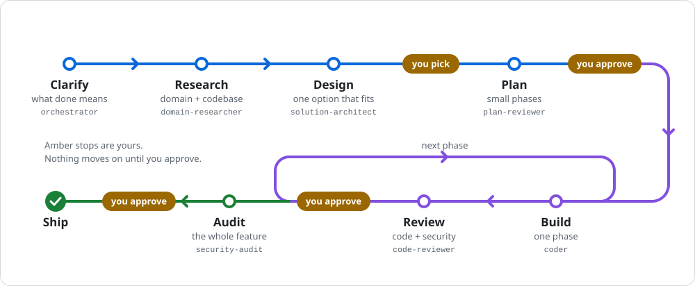

# 🛠️ dev-workflow

**A Claude Code plugin for spec-driven development: research, plan, then build each feature in small reviewed phases. Every phase gets an AI code review with a security pass, and nothing moves on until you approve.**

<p align="center">
  <picture>
    <source media="(prefers-color-scheme: dark)" srcset="https://raw.githubusercontent.com/micahhype/dev-workflow/main/assets/flow-dark.svg">
    
  </picture>
</p>

> Pair programming, except your pair is six robots who *actually read the spec* — and you still hold the almighty **“nope.”**

It works in any domain: the project context comes from your `conventions.md` (written by `/dev-workflow:init`) or is inferred per feature from the code.

## Install

```shell
/plugin marketplace add micahhype/dev-workflow
/plugin install dev-workflow@dev-workflow-marketplace
```

To update later, refresh the catalog and then pull the new code. The [changelog](CHANGELOG.md) lists what's new.

```shell
/plugin marketplace update dev-workflow-marketplace
/plugin update dev-workflow@dev-workflow-marketplace
```

## Quick start

```shell
/dev-workflow:init                       # (optional) learn the repo → conventions.md + project-map.md
/dev-workflow:feature add pagination to the orders endpoint
/dev-workflow:feature --bug the orders endpoint 500s on an empty cart
/dev-workflow:approve                    # approve the phase that is waiting for you
/dev-workflow:status                     # where am I?  (also auto-injected each session)
```

Working docs are created under `.dev-workflow/features/<slug>/`. Several features can run at once; `.dev-workflow/active` names the current one.

## Commands

| Command | Purpose |
|---------|---------|
| `/dev-workflow:init` | Inspect the project and draft `conventions.md` + `project-map.md` |
| `/dev-workflow:architect` | System design before a big feature: NFRs, patterns from the [catalog](references/architecture-patterns.md), diagram, PR slices. `adr <title>` records one decision |
| `/dev-workflow:feature` | Run the whole feature workflow. `--bug` starts with reproduce → root cause → regression |
| `/dev-workflow:approve` | Approve the phase waiting for you (or a phase number, or `final`) |
| `/dev-workflow:status` | The active feature, phase and gate |
| `/dev-workflow:config` | Effective settings, where each came from, and which config lines do nothing |
| `/dev-workflow:dashboard` | Local web board of every project's features, with the ones waiting for you first |
| `/dev-workflow:rollback` | Restore to a checkpoint, reversibly. `rollback list` only lists them |

Two scripts run from your own terminal:

- `python3 <plugin>/hooks/mark_done.py <root> <slug>` ticks every open phase of a feature you already finished as approved. It refuses inside Claude Code.
- `python3 <plugin>/scripts/subagent_traces.py [ROOT]` reads your subagent transcripts and prints tokens and time per agent type.

## Agents

| Agent | Default model | Role |
|-------|---------------|------|
| `domain-researcher` | `opus` | Domain and stack research, plus what the codebase already has |
| `solution-architect` | `opus` | The option that fits, plus priced leaner and safer deltas |
| `plan-reviewer` | inherit | Adversarial plan review before coding |
| `coder` | `opus` | Implements one phase |
| `code-reviewer` | `opus` | Logic and quality review plus a security pass, every phase |
| `security-audit` | `opus` | Deep final audit across all phases |

The defaults are aliases, so each agent runs the newest model of its family without a plugin update. To change them, without editing the plugin:

- **Per agent (recommended):** map agent → model in `.dev-workflow/models.json`. Values are aliases (`opus`/`sonnet`/`haiku`/`fable`), full model IDs for a pinned version, or `inherit`. Start from `templates/models.json`:
  ```json
  { "coder": "sonnet", "security-audit": "opus" }
  ```
- **All agents at once:** set `CLAUDE_CODE_SUBAGENT_MODEL=<model>` before launching.
- **Replace an agent:** put `.claude/agents/<name>.md` in your project. It shadows the plugin's, prompt included.

## Guards

Hooks hold the workflow to its rules. All of them fail open: a hook that errors never blocks your work.

| | Gives you |
|---|---|
| 🔒 [Approval gate](docs/guards.md#approval-gate) | A `LOCKED` gate only you can flip. While locked, Claude cannot edit source or run Bash |
| 💾 [Checkpoints + rollback](docs/guards.md#checkpoints--rollback) | A git snapshot before every edit, and a safe, reversible restore |
| 🧾 [Evidence gate](docs/guards.md#evidence-gate) | "Done" must cite proof. An empty ledger is refused |
| 📏 [Plan guard](docs/guards.md#plan-guard) | Extra phases and blown review budgets must be justified in writing |
| 🗂️ [Workflow state](docs/guards.md#workflow-state--approval) | Progress lives in `state.json`, changed by one command that validates each step and records how your approval arrived |
| ♻️ [Context re-injection](docs/guards.md#context-re-injection) | Workflow state survives `/compact` |
| 💬 [Comment guard](docs/guards.md#comment-guard) | Refuses comments that narrate the diff or talk to the reviewer |
| 🧪 [Test guard](docs/guards.md#test-guard) | Refuses tests with no assertion and providers built from empty fakes |

Also in [docs/guards.md](docs/guards.md): how the plugin [learns rules across features](docs/guards.md#learning-across-features) and the [config readout](docs/guards.md#config-readout).

**Checkpoints run in every git repo**, whether or not a feature is active. The hook writes only to its own shadow refs, never your index, HEAD, branch or worktree, and deletes checkpoints older than 14 days. The other guards stay silent when no workflow is active.

## How it is designed

- **Files are the source of truth.** `spec.md`, `plan.md` and `state.json` survive `/compact` and `/clear`.
- **You review after the AI reviewers**, at every phase. Nothing advances unapproved.
- **The machinery scales with the change.** A feature is trivial by default and runs as one phase; research, the architect and the final audit are added only when the change needs them.
- **Review loops are bounded.** After two fix rounds, you decide.
- **Bugs use the same workflow** with a different start: reproduce → root cause → regression.

The reasoning behind each of these is in [docs/design.md](docs/design.md).

## Requirements

- **`python3` on PATH.** The hooks are invoked as `python3`; check with `python3 --version`. On Windows with a python.org install you may only have `python` and `py`, so add a `python3` shim. If `python3` is missing the hooks cannot launch, and because they fail open you get **no approval gate, no checkpoints and no evidence gate, silently**.
- **Git**, for checkpoints and rollback. Everything else works without it.
- Add **`.dev-workflow/`** to your project `.gitignore`.
