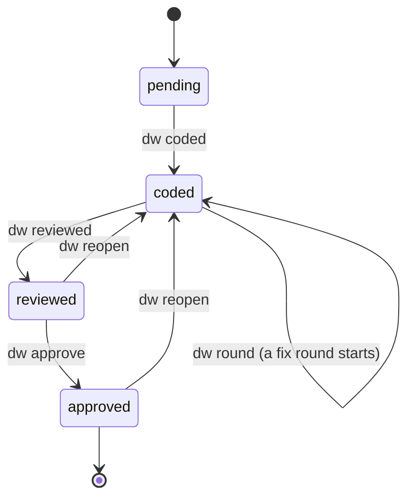

# Workflow state in `state.json`

Status: accepted · 2026-11-18

## Problem

A feature's progress lives in `phase-log.md`, and five programs read it with regular
expressions: `status.py`, `evidence_guard.py`, `plan_guard.py`, `dashboard.py` and
`mark_done.py`. Three things follow from that.

- **A formatting slip disables a guard without a message.** A heading the parser does
  not recognise is absorbed into the phase above it. The feature skill carries a table
  of strings that must be written character for character to prevent this.
- **Nothing validates a transition.** A phase can be marked reviewed before it is
  coded, or approved with an empty evidence ledger. The Stop hooks notice some of this
  afterwards and give up after three refusals.
- **The user's approval is a checkbox the model writes.** No program can tell the
  model's tick from the user's.

## Goals

1. One file per feature holds the machine state. Every program reads it the same way.
2. State changes go through one command that validates the transition and refuses with
   a reason.
3. An approval records how it arrived, and the model cannot record one in a turn where
   the user said nothing.
4. Features already in flight keep working without conversion.

## Not in this design

- `plan.md` stays a hand-written document, parsed as today, and its approval is not
  recorded in the state.
- `.approval-gate` stays a manual, opt-in lock.
- The refusal counters and the diff-budget baseline stay in their own files.

## Design

### Files

```
.dev-workflow/
  dw                      shim that runs the plugin's CLI (rewritten each session)
  active                  slug of the active feature (unchanged)
  features/<slug>/
    state.json            machine state — written only by `dw`
    phase-log.md          rendered from state.json after every write
    spec.md  plan.md      unchanged
```

`state.json` is the source of truth. `phase-log.md` becomes a generated view: it keeps
its current layout so people, the lessons step and `since-ship` read it as before, and
it opens with a line saying it is generated. A hand edit is overwritten by the next
write.

### Schema

```json
{
  "version": 1,
  "slug": "orders-pagination",
  "title": "Paginate the orders endpoint",
  "tier": "standard",
  "phases": [
    {
      "id": 1,
      "title": "Cursor query and response shape",
      "status": "reviewed",
      "rounds": 1,
      "security_scanned": true,
      "changed": "src/orders/list.ts — cursor on (created_at, id)",
      "evidence": "`npm test orders` -> 14 passed; ...",
      "review_summary": "38 must-read / 12 skim / 0 skip of 50 changed lines",
      "review_map": [
        {"tier": "MUST", "text": "`src/orders/list.ts:20-58` — builds the cursor → is a tie on created_at stable?"},
        {"tier": "ASSUME", "text": "page size defaults to 20"}
      ],
      "review_result": "1 BLOCKING (unstable sort), fixed in round 1",
      "unresolved": null,
      "deferred_nits": "rename `rows` -> `orders`",
      "over_budget": null,
      "user_notes": null,
      "approval": null
    }
  ],
  "final_review": null,
  "project_map": null,
  "lessons": null,
  "post_ship_reviewed": null,
  "events": [
    {"at": "2026-11-18T03:10:02Z", "by": "coder", "do": "coded", "phase": 1},
    {"at": "2026-11-18T03:18:40Z", "by": "orchestrator", "do": "round", "phase": 1}
  ]
}
```

- `final_review` is `null` for a single-phase feature and a phase-shaped object
  otherwise. This replaces "delete the Final review section when Stage 5 is skipped".
- `project_map`, `lessons` and `post_ship_reviewed` sit on the feature, so they no
  longer move between the last phase and the final review.
- `approval` is `{"at": ..., "via": "user" | "relayed" | "marked-done", "quote": ...}`.
- `events` is append-only. It gives the time spent per phase and per round without
  anyone reporting it.

### Phase state machine



Each transition has preconditions. A refused command exits non-zero and prints what is
missing.

| Command | Refuses unless |
|---|---|
| `dw coded N` | every earlier phase is approved; `changed` and `evidence` are given |
| `dw round N` | phase N is `coded` |
| `dw reviewed N` | phase N is `coded`; the review map has at least one entry; `rounds` over 2 comes with `unresolved` |
| `dw phases` | no phase has started; `dw add-phase` appends after that |
| `dw approve N` | phase N is `reviewed`; evidence is at least 15 characters; the approval rule below holds |
| `dw reopen N` | phase N is `reviewed` or `approved`; clears the approval |

`rounds` is counted by `dw round`, so it is a measurement and no longer a number the
orchestrator writes.

### Command line

`hooks/dw.py`, reached through the `.dev-workflow/dw` shim that the SessionStart hook
writes with the plugin's current path. Agents and the user type the same short command.

```
dw new <slug> "<title>" [--tier T]     scaffold the feature, make it active
dw phases "<title>" ["<title>" ...]    set the phase list after the plan is approved
dw add-phase "<title>"                 append a phase once work has started
dw coded N --changed "<text>"          evidence on stdin
dw round N                             a fix round starts
dw reviewed N [--security]             review map on stdin, one entry per line
dw set N <field>                       text on stdin: evidence, review_result, unresolved,
                                       deferred_nits, over_budget, user_notes
dw set feature <field>                 project_map, lessons, post_ship_reviewed
dw approve [N] [--said "<quote>"]
dw reopen N
dw status [--json]                     what SessionStart prints and the dashboard reads
dw check                               what the Stop hooks would refuse the turn for
dw import <slug>                       build state.json from a legacy phase-log.md
```

Every write takes a lock file, reads, validates, writes to a temporary file, renames
it over `state.json`, then renders `phase-log.md`.

### Approval

An approval is accepted through one of two routes.

| Route | How | Recorded as |
|---|---|---|
| Direct | the user types `/dev-workflow:approve`, runs `! .dev-workflow/dw approve`, or presses the dashboard button | `via: "user"` |
| Relayed | the user approves in plain words and the orchestrator runs `dw approve --said "<their words>"` | `via: "relayed"` with the quote |

- `/dev-workflow:approve` is recorded by a `UserPromptExpansion` hook. That event fires
  only for a command the user typed; Claude calling the command does not reach it, and
  the command is marked so Claude cannot invoke it at all.
- A `UserPromptSubmit` hook stamps the time of every prompt the user sends. A relayed
  approval is refused unless that stamp is at or after the time the phase was reviewed.
  This closes the case that matters most: a phase approved in the turn that reviewed it.
- Claude Code also raises `UserPromptSubmit` for turns it starts itself, such as a
  background agent reporting back, and gives the hook no field that tells them apart.
  The hook skips the ones it can recognise by their text. One it does not recognise
  would count as the user speaking, so `direct` mode is the strict choice.
- `dw approve` without `--said` refuses when it runs inside Claude Code.
- `approval.mode` in the project config is `relayed` (default) or `direct`. With
  `direct`, relayed approvals are refused.

This is a guard and not a security boundary: the model has a shell and can write any
file the user can. What changes is that forging an approval now takes a deliberate
workaround, where today it takes ticking the box the prompt describes.

### Hooks

| Hook | Today | With `state.json` |
|---|---|---|
| `status.py` (SessionStart) | parses headings and ticks | prints `dw status`; rewrites the shim |
| `evidence_guard.py` (Stop) | parses the current phase | same check, on the log rendered from the state |
| `plan_guard.py` (Stop) | parses `plan.md` and `phase-log.md` | same checks, on the log rendered from the state |
| `gate.py` (PreToolUse) | guards `.approval-gate` | also denies the edit tools on a feature's `state.json` and on the `phase-log.md` rendered beside it, naming the command to use. Bash is not filtered: this is a signpost for the model, like the rest of the gate |
| new `prompt.py` (UserPromptSubmit, UserPromptExpansion) | — | stamps the prompt time; records `/dev-workflow:approve` |
| `dashboard.py`, `mark_done.py` | parse and rewrite markdown | read the log rendered from `state.json`; Mark done approves every open section in the state, recorded as `via: "marked-done"` |

The Stop hooks keep their bound of three refusals. Most of what they catch today
becomes a precondition, so they are left with one job: a turn that ends while the
record is incomplete.

A `state.json` that cannot be parsed makes the hooks fail open, as today, but with a
message naming the file. Silence is reserved for projects with no active feature.

### Feature skill and agents

- The "machine-parsed strings" table in `SKILL.md` is replaced by the command list.
- `coder` runs `dw coded`; the orchestrator runs `round`, `reviewed`, `set` and the
  relayed `approve`. Reviewers stay read-only and write nothing.
- Skills pre-approve the `dw` command in `allowed-tools`, so it does not prompt.
- While `.approval-gate` is `LOCKED`, Bash is denied and so is `dw`. Direct approval
  does not go through the model's Bash, so the locked flow still completes.

## Legacy features

A feature directory without `state.json` is legacy. Readers get a feature's log from one
function, `state.log_text(dir)`: rendered from `state.json` when the feature has one,
otherwise the hand-written `phase-log.md`. The status hook, the dashboard and the guards
keep their current parser and read that text, so a legacy feature behaves exactly as
before and a stale or hand-edited rendered log cannot mislead them. `hooks/legacy.py`
converts a hand-written log into the state structure for `dw import`.

A `state.json` counts only inside `.dev-workflow/features/<slug>/`. The old layout keeps
its docs at the project root, where a `state.json` may belong to the project itself.

- Finished legacy features are never converted. The dashboard shows them as before.
- A legacy feature in flight keeps the old rules until `dw import <slug>` converts it.
  The import keeps the fields the state knows; the hand-written log is preserved next to
  it as `phase-log.legacy.md`, so free-form notes are not lost.
- New features always get `state.json`.

## Risks

| Risk | Mitigation |
|---|---|
| More Bash round-trips than one Edit that ticks several boxes | Commands are compound: `coded` carries changed and evidence, `reviewed` carries the map and the security flag. A phase needs about four calls. |
| Long text through stdin is awkward for the model | `dw set` also takes `--file <path>` |
| Two writers at once (coder, orchestrator, dashboard) | Lock file around read-modify-write; atomic rename |
| The shim is a `sh` script holding an absolute path, so it does not run on Windows and should not be committed | `.dev-workflow/` is meant to be gitignored; on Windows, call `python3 <plugin>/hooks/dw.py` |
| The shim points at an old plugin path after an update | SessionStart rewrites it; `dw status` prints the plugin version |
| Rendered `phase-log.md` drifts from what people expect | A test renders a fixture and compares it with the current template layout |
| The relayed route accepts a prompt that was not an approval | The quote is stored and shown in the dashboard; `direct` mode removes the route |

## Delivery

Stacked PRs, each mergeable alone and under 300 changed lines where possible.

1. **State library.** `hooks/state.py`: schema, load, validated transitions, lock and
   atomic write, renderer. Tests only; nothing uses it yet.
2. **CLI and shim.** `hooks/dw.py`, the shim in `status.py`, `dw import`.
3. **Readers.** `state.log_text`; `status.py`, `dashboard.py` and `mark_done.py` switch
   to it. No behaviour change for legacy features.
4. **Guards.** `evidence_guard.py` and `plan_guard.py` read the log through
   `state.log_text`; `dw check` reports the same findings on demand; `gate.py` protects
   the generated files.
5. **Approval.** The prompt hook, `/dev-workflow:approve`, the relayed rule,
   `approval.mode` in the config readout (`.dev-workflow/approval.json`).
6. **Prompts.** `SKILL.md`, `coder.md`, templates and README move to the commands.
   This is the PR that turns the new path on for new features.

## Decisions

1. **The default `approval.mode` is `relayed`.** Approving in plain words keeps working;
   `direct` is there for a project that wants only explicit approvals.
2. **Plan approval is not recorded in version 1.** The state covers phases and the final
   review. Recording the Stage 3 approval the same way can follow once phase approval
   has been used for a while.
3. **The shim lives at `.dev-workflow/dw`.** The model can edit that directory, which is
   the same trust level as the rest of the design; SessionStart rewrites the shim every
   session.
